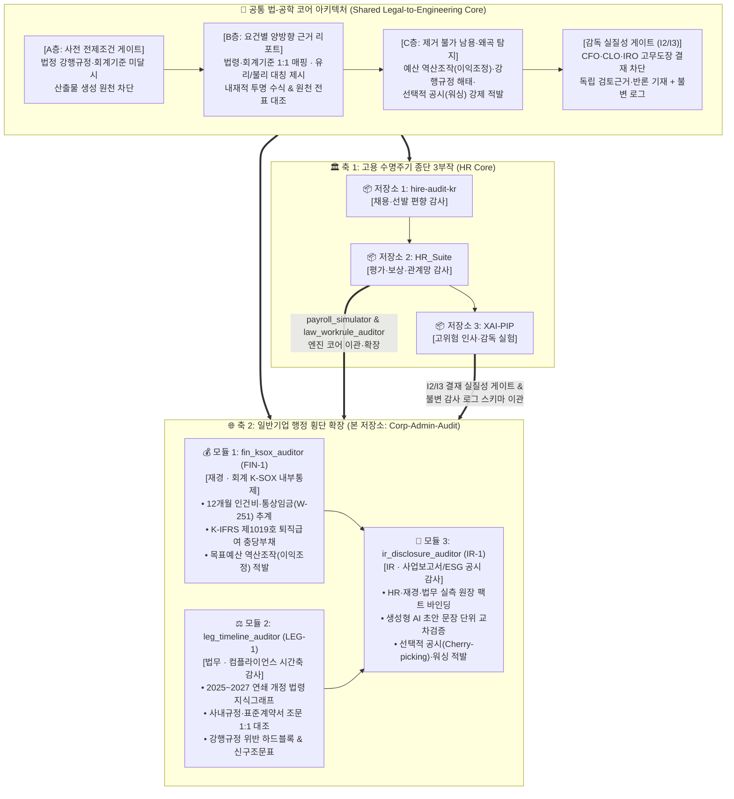

# Corp-Admin-Audit — 기업 재경(K-SOX)·법무(시간축)·IR(공시) 행정 AI 감사 및 인적 감독 실질성 검증 스위트

> **문서 버전**: `v1.0.0` (Master Specification & SSOT Blueprint)  
> **이중 트랙 위상**: **Track R** (박사 학위 논문 제4부: 외적 타당성 입증 & SCIE/SSCI Q1 3편 `FIN-1`·`LEG-1`·`IR-1`) × **Track P** (폐쇄망/하이브리드 B2B 기업 행정 내부통제 RegTech 스위트)  
> **4대 분리 저장소 포트폴리오 연동**: [`hire-audit-kr`](https://github.com/489156/hire-audit-kr) (제1부: 채용 진입) ➔ [`HR_Suite`](https://github.com/489156/HR_Suite) (제2부: 평가·보상·관계망) ➔ [`XAI-PIP`](https://github.com/489156/XAI-PIP) (제3부: 고위험 인사·감독 실험) ➔ **`Corp-Admin-Audit` (제4부: 일반기업 행정 횡단 확장)**

---

## 목차 (Table of Contents)

0. [4대 분리 저장소(4-Repository) 포트폴리오 위상 및 유기적 연계 구조도](#0-4대-분리-저장소-포트폴리오-위상-및-유기적-연계-구조도)
1. [기획 의도 및 문제 정의 (Why Corp-Admin-Audit?)](#1-기획-의도-및-문제-정의-why-corp-admin-audit)
2. [학술 연구 주제 및 목표 저널 매핑 (Track R: `FIN-1` · `LEG-1` · `IR-1`)](#2-학술-연구-주제-및-목표-저널-매핑-track-r-fin-1--leg-1--ir-1)
3. [공통 규범 아키텍처: 3층 감사(A·B·C층) 및 결재 실질성(`I2/I3`) 명세](#3-공통-규범-아키텍처-3층-감사abc층-및-결재-실질성i2i3-명세)
4. [3대 행정 도메인 모듈별 상세 기능 및 수리·알고리즘 명세](#4-3대-행정-도메인-모듈별-상세-기능-및-수리알고리즘-명세)
5. [비개발자 현업 실무자(재경·법무·IR) 친화형 UX 구현 계획 및 한글 GUI 와이어프레임](#5-비개발자-현업-실무자재경법무ir-친화형-ux-구현-계획-및-한글-gui-와이어프레임)
6. [저장소 디렉토리 구조 및 거버넌스 가드 (Repository Structure & CI Guards)](#6-저장소-디렉토리-구조-및-거버넌스-가드-repository-structure--ci-guards)
7. [비개발자·연구자를 위한 핵심 공학·회계·법학 용어 쉬운 풀이 사전](#7-비개발자연구자를-위한-핵심-공학회계법학-용어-쉬운-풀이-사전)
8. [합성 엔터프라이즈 벤치마크 검증 프로토콜 ($\mathcal{S}_{FIN}, \mathcal{S}_{LEG}, \mathcal{S}_{IR}$)](#8-합성-엔터프라이즈-벤치마크-검증-프로토콜-mathcal_s_fin-mathcal_s_leg-mathcal_s_ir)

---

## 0. 4대 분리 저장소 포트폴리오 위상 및 유기적 연계 구조도

본 저장소(`Corp-Admin-Audit`)는 인사(HR) 도메인 3부작([`hire-audit-kr`](https://github.com/489156/hire-audit-kr), [`HR_Suite`](https://github.com/489156/HR_Suite), [`XAI-PIP`](https://github.com/489156/XAI-PIP))에서 확립한 **[A층 사전 전제조건 하드게이트 · B층 요건별 양방향 근거 리포트 · C층 제거 불가능 남용/왜곡 탐지 + `I2/I3` 인적 감독 실질성 로깅]** 프레임워크가 인사 영역에만 국한된 특수 기법이 아니라, **기업의 4대 핵심 백오피스 행정(인사 · 재경 · 법무 · IR) 전반에 보편적으로 성립하는 '일반기업 행정 AI 내부통제 표준 원리'**임을 실증하는 제4저장소입니다.



---

## 1. 기획 의도 및 문제 정의 (Why Corp-Admin-Audit?)

### 1.1 기업 행정(재경 · 법무 · IR) AI 도입의 3대 구조적 실패 양상

일반기업의 백오피스 행정(재무·회계, 법무·컴플라이언스, IR·공시)은 의사결정 하나가 곧바로 **외부감사인의 내부회계관리제도(K-SOX) 부적정 의견, 근로감독·공정위 시정명령, 자본시장법상 허위·부실공시 제재**로 직결되는 고위험 규범 영역입니다. 그러나 현업에 도입되는 생성형 AI 및 스프레드시트 자동화 도구는 다음 3가지 구조적 실패를 야기하고 있습니다.

1. **재경(Finance) 행정 — '목표 예산 맞춤 역산 조작(Goal-Seeking Earnings Management)'의 은폐:**
   - 정기 승진·임금 인상이나 결산 시점에 경영진이 설정한 목표 영업이익 또는 가용 예산 한도에 총인건비를 억지로 맞추기 위해, 2024년 12월 대법원 전원합의체 판결(`2020다247190`, `2023다302838`)로 통상임금성이 인정된 조건부 정기상여금을 산식에서 고의로 누락(`W-251`)하거나 확정급여형(DB) 퇴직급여 충당부채 할인율·추계 기준을 임의 조정하는 왜곡이 발생합니다.
2. **법무(Legal) 행정 — '연쇄 개정 법령의 시간축(Point-in-Time) 환각 및 개정 해태':**
   - 2025년~2027년 사이 한국 기업 관련 법령은 수개월 간격으로 연쇄 발효됩니다(예: 2026.8.20. 단기 육아휴직 신설, 2026.9.18. 배우자 출산전후휴가 50일 전 사용 및 유산·사산휴가 신설, 2026.10.8. 임금체불 법정형 상향, 2026.11.27. 난임휴가 유급 4일 확대 및 법인 대표자 성희롱 규율 확대, 2026.12.10. 4시간 근무 시 휴게 면제 등). 일반 LLM은 학습 시점 이후의 시행일(`Effective Date`) 분기 조건을 구분하지 못해 구법 조문을 적법하다고 오판(Temporal Hallucination)합니다.
3. **IR(공시) 행정 — '생성형 AI 공시 초안의 선택적 취사선택(Cherry-Picking) 및 워싱(Washing)':**
   - 사업보고서(DART), 지속가능경영보고서(ESG 인적자본·지배구조 공시), IR 설명자료를 LLM으로 작성할 때, 사내 원장(인사·재경·법무 DB) 중 유리한 지표만 발췌해 과장하고 불리한 지표(육아휴직 복귀 후 퇴사율, 통상임금 소송 충당부채 위험, 미시정 법규 위반 건수 등)는 교묘히 누락하는 'AI 매개 공시 워싱'이 발생합니다.

### 1.2 기획 의도: "법·회계 기준의 코드화 + 제거 불가능 왜곡 탐지(C층) + 임원 결재 실질성(`I2/I3`)"

`Corp-Admin-Audit`는 [`HR_Suite`](https://github.com/489156/HR_Suite)에서 검증된 인건비 시뮬레이터 및 법제 대조 엔진과 [`XAI-PIP`](https://github.com/489156/XAI-PIP)에서 검증된 `I2/I3` 감독 실질성 로깅 아키텍처를 결합하여 다음 두 가지 목표를 동시에 달성합니다.

- **[Track P — 현업 비개발자용 폐쇄망 RegTech 제품]:** 코딩을 모르는 재경팀·법무팀·IR팀 실무자가 엑셀/워드 파일만 드래그 앤 드롭하면 ① 12개월 인건비·퇴직충당금 K-SOX 감사 시트, ② 개정 법령 대비 사내규정·계약서 신구조문 대비표, ③ 원장 팩트와 1:1 연결된 IR 공시 팩트체크 리포트를 1초 만에 생성합니다.
- **[Track R — 박사 학위 논문 제4부 및 SCIE/SSCI Q1 3편]:** 인사(HR)에서 출발한 3층 감사(A·B·C층) 및 `I2/I3` 인적 감독 실질성 프레임워크가 재무회계(K-SOX), 법무 컴플라이언스, 자본시장 공시 도메인에서도 경영진의 '고무도장 결재(Rubber-Stamping)'와 '수치·문구 마사지'를 유의미하게 억제함을 입증합니다.

---

## 2. 학술 연구 주제 및 목표 저널 매핑 (Track R: `FIN-1` · `LEG-1` · `IR-1`)

| 논문 코드 | 행정 도메인 | 학술 연구 주제 (국문 / 영문) | 핵심 연구 질문 (RQ) 및 공학적 기여 | 목표 학술지 (SSCI / SCIE) |
| :--- | :--- | :--- | :--- | :--- |
| **`FIN-1`** | **재경 · 회계**<br>(K-SOX / ICFR) | **인건비·퇴직충당금 시뮬레이션의 3층 내부회계 감사 아키텍처와 재무 결정권자의 이익조정 억제 효과**<br>*(Three-Layer Auditable Payroll & Severance Simulation under K-SOX: Curb on Goal-Seeking Earnings Management)* | • **RQ1:** `@soft_compute` 결측 격리(A층)와 통상임금/퇴직충당 역산 조작 탐지(C층 `W-251`)가 K-SOX 통제 오류를 얼마나 감소시키는가?<br>• **RQ2:** `I2/I3` 독립 근거 기재를 강제할 때 재무 결재자의 예산 맞춤 역산(Goal-seeking) 승인이 얼마나 억제되는가? | *International Journal of Accounting Information Systems* / *Journal of Accounting and Public Policy* |
| **`LEG-1`** | **법무 · 규범**<br>(RegTech) | **연쇄 개정 법령의 시점별(Point-in-Time) 지식그래프와 사내규정·표준계약서 자동 적합성 감사**<br>*(Temporal Legal Knowledge Graphs for Automated Corporate Rulebook & Contract Compliance Auditing)* | • **RQ1:** 시행일(`effective_date`) 분기 결정론적 규칙 그래프가 일반 LLM RAG 대비 시점 착오(Temporal Hallucination)를 얼마나 제거하는가?<br>• **RQ2:** `[즉시개정 필수(A층 차단)]` vs `[사전개정 권고(B층)]` 이원화가 법무 검토 시간과 누락률을 얼마나 단축하는가? | *Artificial Intelligence and Law* (Springer, Q1) / *Computer Law & Security Review* |
| **`IR-1`** | **IR · 공시**<br>(Capital Market) | **원장 구속형(Ledger-Bound) 생성형 AI 공시 감사: 사업보고서·ESG 공시의 선택적 누락 및 워싱 탐지**<br>*(Ledger-Bound Auditing of Generative Corporate Disclosures: Detecting Selective Omission and Washing in IR & ESG Reports)* | • **RQ1:** 사내 정형 원장(HR·재경·법무 DB)과 비정형 공시 초안 간의 문장 단위 양방향 수식 바인딩이 선택적 공시(Cherry-picking)를 어떻게 적발하는가?<br>• **RQ2:** 공시 확정 전 `I2/I3` 소명 게이트가 그린워싱/소셜워싱 리스크를 어떻게 통제하는가? | *Decision Support Systems* (Q1) / *Journal of Business Ethics* / *Corporate Social Responsibility and Environmental Management* |

---

## 3. 공통 규범 아키텍처: 3층 감사(A·B·C층) 및 결재 실질성(`I2/I3`) 명세

본 저장소의 3대 모듈(`fin_ksox_auditor`, `leg_timeline_auditor`, `ir_disclosure_auditor`)은 자매 저장소 [`XAI-PIP`](https://github.com/489156/XAI-PIP) 및 [`hire-audit-kr`](https://github.com/489156/hire-audit-kr)와 동일한 **3층 감사 구조 + 결재 실질성 게이트**를 강제합니다.

| 감사 계층 | 재경 모듈 (`fin_ksox_auditor`) | 법무 모듈 (`leg_timeline_auditor`) | IR·공시 모듈 (`ir_disclosure_auditor`) |
| :--- | :--- | :--- | :--- |
| **A층: 사전 전제조건 하드게이트**<br>*(위반 시 산출물 확정 원천 차단)* | • **2026 최저임금(월 2,156,880원) 미달 차단**<br>• **법정보호 휴직 불이익(`E-231`) 차단**<br>• **`@soft_compute` 미확정 변수 격리:** 미입력 요율은 에러 대신 `🟧 ⏳ 미산정`으로 격리하여 허위 확정 수치 생성 차단 | • **발효 완료(`effective_date <= today`) 강행규정 위반 시 적법 인증서 발급 차단**<br>• 필수 법정 기재사항(임금 구성항목·계산방법·지급방법 등) 누락 계약서 배포 차단 | • **원장 미연결(Unbound Claim) 수치 공시 차단:** 사내 DB 원장 해시(`ledger_sha256`)와 연결되지 않은 정량 수치가 초안에 포함될 경우 발행 차단 |
| **B층: 요건별 양방향 근거 리포트**<br>*(투명 산식 & 대칭적 정보 제시)* | • 승진·임금 인상 전/후 12개월 인건비 순증액($\Delta TC$)을 기본급·수당·4대보험·퇴직충당 요인별로 완전 분해<br>• K-IFRS 제1019호 평균임금 vs 통상임금 대조표 제시 | • 현행 사내규정 조문 vs 개정 법령 조문 **1:1 신구조문 대비표** 및 법적 근거 조항 병기<br>• 시행 예정 법안(`effective_date > today`) 사전 개정 로드맵 제시 | • 공시 초안의 모든 주장 문장 옆에 **[원장 정합 지표(유리)]**와 **[누락된 반대 지표(불리/리스크)]**를 1:1 대칭 카드로 병렬 제시 |
| **C층: 제거 불가능 왜곡·남용 탐지**<br>*(행위자 대칭성 보장 — 비활성화 불가)* | • **예산 역산 조작(`GSI`, Goal-Seeking Index) 적발:** 목표 예산에 맞추기 위해 정기상여의 통상임금 산입을 고의 해제(`W-251`)하거나 퇴직충당률을 하향 조정한 흔적 강제 적발 | • **강행규정 개정 해태 및 독소조항 적발:** 시행일이 경과했음에도 구법 기준(예: 배우자 출산휴가 10일, 단기육아휴직 미반영)을 유지하거나 불리한 특약을 삽입한 조항 강제 적발 | • **선택적 공시 지수(`SDI`, Selective Disclosure Index) 적발:** 긍정 지표만 공시하고 동일 도메인의 부정 지표(예: 통상임금 우발부채, 안전·노동 법규 시정명령)를 누락한 워싱 강제 적발 |
| **감독 실질성 (`I2/I3` 결재 로깅)**<br>*(임원 고무도장 결재 차단)* | CFO/재경팀장이 `W-251` 통상임금 경고나 `GSI` 역산 의심 플래그를 예외 승인할 때 **외부 법률·회계 자문 의견서 번호(`I2`) 및 충당금 보완 계획(`I3`)** 기재 강제 | CLO/법무팀장이 `[즉시개정 필수]` 조문의 개정을 유예할 때 **노사합의 진행 증빙(`I2`) 및 경과조치 적용 근거(`I3`)** 기재 강제 | IRO/공시책임자가 `SDI` 선택적 누락 경고를 우회하여 원안 공시할 때 **중요성(Materiality) 판단 독립 근거(`I2`) 및 주석 공시 보완안(`I3`)** 기재 강제 |

---

## 4. 3대 행정 도메인 모듈별 상세 기능 및 수리·알고리즘 명세

### 4.1 모듈 1 (`fin_ksox_auditor`): 재경 K-SOX 인건비·퇴직충당금 추계 및 예산 역산 조작 감사기

[`HR_Suite`](https://github.com/489156/HR_Suite)의 `payroll_simulator.py`(`ADR-0024`, `ADR-0025`)를 기업 재무회계(K-SOX/ICFR 및 K-IFRS 제1019호) 수준으로 승격한 모듈입니다.

1. **회계연도 12개월 구간(Segment) 정밀 추계 및 통상임금 판례(`W-251`) 검증:**
   - 임원·직원의 승진/승호 발령월 $m^*$부터 12월 말까지의 직접 인건비($\Delta B, \Delta A, \Delta I$), 사업장 규모·기간별 4대보험 회사부담금($\Delta Ins$), 퇴직급여 충당부채 전입액($\Delta Ret$)을 산출합니다.
   - **확정급여형(DB) 퇴직급여 충당금 보수성 검증:** 월별 퇴직충당금 산정 기준임금 $W_{ret,i,m} = \max(\overline{W}_{avg,i,m}, W_{ord,i,m})$ (평균임금 추계치와 대법원 2024.12 전원합의체 기준 통상임금 중 큰 금액)을 강제 적용하여 퇴직부채 과소계상을 방지합니다.
2. **C층 예산 역산 조작 지수 ($GSI$, Goal-Seeking Manipulation Index):**
   - 재무 실무자나 부서장이 경영진의 목표 예산 한도 $B_{target}$에 총인건비 순증액 $\Delta TC$를 맞추기 위해 초기 설정($t_0$) 대비 확정 설정($t_1$)에서 통상임금 산입 수당 집합 $\Omega_{ord}$를 축소하거나 충당률 파라미터 $\theta$를 인위적으로 낮춘 비율을 측정합니다.

$$
GSI = \frac{\Delta TC(\Omega_{ord}^{(t_0)}, \theta^{(t_0)}) - \Delta TC(\Omega_{ord}^{(t_1)}, \theta^{(t_1)})}{\max\left(\Delta TC(\Omega_{ord}^{(t_0)}, \theta^{(t_0)}) - B_{target},\; \epsilon\right)}
$$

   - **판정 규칙:** 초기 산출액이 예산 한도를 초과($\Delta TC^{(t_0)} > B_{target}$)한 상태에서 인원 조정 없이 수당의 통상임금 산입 해제(`W-251`)나 요율 임의 축소만으로 $\Delta TC^{(t_1)} \le B_{target}$을 달성하여 $GSI \in [0.7, 1.05]$ 구간에 진입하면 **🟥 `[C층 적발: K-SOX 목표예산 역산 조작(이익조정) 의심]`** 경보를 발령하고, CFO의 `I2/I3` 독립 근거 입력 없이는 결산 시트 확정을 차단합니다.

### 4.2 모듈 2 (`leg_timeline_auditor`): 법무 시간축(Point-in-Time) 법령 지식그래프 및 사내규정·계약서 감사기

[`HR_Suite`](https://github.com/489156/HR_Suite)의 `law_workrule_auditor.py`를 노동법뿐만 아니라 공정거래·하도급·개인정보·상법 등 일반기업 사내규정 및 표준계약서 전반으로 확장한 모듈입니다.

1. **시점 인식(Point-in-Time) 결정론적 법령 버전 그래프 ($G_{law}$):**
   - 각 법령 조문 노드를 `(법령ID, 조문번호, 시행일 effective_date, 폐지일 expiry_date, 강행규정여부 is_mandatory, 최소기준치 min_threshold)` 튜플로 구조화합니다.
   - 감사 기준일 $t_{audit}$과 계약/규정 적용 기간 $[t_{start}, t_{end}]$를 대조하여, 기준일 현재 이미 시행 중인 조문 위반은 **🟥 `[A층 하드블록: 즉시개정 필수]`**, 향후 6개월 내 시행 예정인 조문 미반영은 **🟧 `[B층 권고: 사전개정 준비]`**로 오차 없이 분류합니다.
2. **내장된 2025~2027 핵심 기업 행정 법령 타임라인 룰셋 (`rules/kr_corporate_law_2025_2027.yaml`):**
   - **2025.02.23 시행:** 배우자 출산휴가 20일 유급(3회 분할), 미숙아 출산전후휴가 100일.
   - **2026.01.01 시행:** 2026년 최저임금 시간급 10,320원 (월 209시간 기준 2,156,880원).
   - **2026.08.20 시행:** **단기 육아휴직(연 1회, 1주 또는 2주)** 신설 및 출근 간주, 육아기 근로시간 단축 대상 만 12세(초6) 이하 확대.
   - **2026.09.18 시행:** **배우자 출산전후휴가(출산예정일 50일 전부터 사용)**, **배우자 유산·사산휴가(5일 범위, 최초 3일 유급)** 신설, 임신 중 배우자 돌봄 육아휴직 허용, 퇴직급여 체불 법정형 상향(5년/5천만원).
   - **2026.10.08 시행:** 임금 체불 범죄 법정형 상향(5년 이하 징역 또는 5천만원 이하 벌금).
   - **2026.11.27 시행:** **난임치료휴가 유급 4일** 확대(연 6일 중), **직장 내 성희롱 규율·교육·과태료 대상에 법인 대표자 및 대표자 친족인 상급자·근로자 명시**.
   - **2026.12.10 시행:** **1일 4시간 근무 시 근로자 명시적 요청에 따른 30분 휴게시간 면제** 특례 신설.
   - **2027.06.10 시행 예정:** 연차휴가 반일(반차, 4시간) 분할 사용 법제화 및 불이익 처우 벌칙 신설.

### 4.3 모듈 3 (`ir_disclosure_auditor`): IR 사업보고서·ESG 공시 원장 바인딩 및 선택적 공시(워싱) 감사기

생성형 AI가 작성한 사업보고서(DART), 지속가능경영보고서(ESG), IR 보도자료 초안을 사내 정형 원장(`HR_Suite` 인사 원장 + `fin_ksox_auditor` 재무 원장 + `leg_timeline_auditor` 법무 원장)과 문장 단위로 대조하는 모듈입니다.

1. **원장 해시 바인딩 (Ledger-Bound Fact Verification):**
   - 공시 초안 내 모든 수치·주장 문장 $s_k$를 추출하여 사내 원장 테이블의 실제 지표 집합 $\mathcal{M}_{ledger}$와 매핑합니다. 원장에 근거가 없는 수치(Hallucinated Metric)가 발견되면 **🟥 `[A층 차단: 원장 미연결 허위 수치]`**로 즉시 차단합니다.
2. **C층 선택적 공시 및 워싱 지수 ($SDI$, Selective Disclosure Index):**
   - 특정 공시 토픽 $d$(예: 일·가정 양립, 인적자본 투자, 우발부채, 내부통제)에 속한 전체 원장 지표들의 표준화 성과 점수 집합 $\{z_{d,1}, \dots, z_{d,M}\}$ 중, IR 초안에 실제로 채택되어 언급된 지표 집합 $S_{cited} \subset \{1, \dots, M\}$의 편향도를 측정합니다.

$$
SDI_d = \frac{1}{|S_{cited}|}\sum_{j \in S_{cited}} z_{d,j} - \frac{1}{M}\sum_{m=1}^{M} z_{d,m}
$$

   - **판정 규칙:** $SDI_d > +1.0\sigma$ 이면서 해당 토픽 내 중대 부정 지표($z_{d,m} < -1.5\sigma$, 예: `W-251` 통상임금 소송 잠재 채무, 법정 의무교육 미이수, 육아휴직 복직 후 6개월 내 퇴사율 급증 등)가 공시 초안에서 100% 누락된 경우 **🟥 `[C층 적발: 선택적 공시(Cherry-Picking) 및 워싱 의심]`** 경보를 발령하고, 누락된 부정 지표를 나란히 보여주는 **B층 대칭 공시 권고안**을 자동 생성합니다.

---

## 5. 비개발자 현업 실무자(재경·법무·IR) 친화형 UX 구현 계획 및 한글 GUI 와이어프레임

[`HR_Suite`](https://github.com/489156/HR_Suite)와 동일하게 **CLI 명령어 입력 제로(Zero-CLI), 영문 에러코드 노출 제로, 4색 엑셀 컬러 코딩(`🟩 입력 #E2EFDA` · `⬜ 수식보호 #F2F2F2` · `🟧 미산정/권고 #FCE4D6` · `🟥 법적위반/왜곡차단 #F8CBAD`)** 원칙을 준수합니다.

### 5.1 3대 모듈별 범용성(Universality) × 비개발자 편의성(Usability) 설계

| 모듈 구분 | 범용성 확보 설계 (전 기업·전 업종 무수정 호환) | 비개발자 편의성 설계 (클릭형 한글 마법사 & 라이브 엑셀) |
| :--- | :--- | :--- |
| **0. 통합 기업행정 감사 런처**<br>(`corp_audit_main.py`) | • `기업행정_설정마스터.xlsx` 파일 하나로 회계기준일, 사업장 규모, 사내규정 목록, 공시 기준연도를 동적 로드<br>• `@soft_compute`로 미확정 계정과목은 `🟧 ⏳ 미산정` 자동 우회 | • 파이썬 미설치 PC용 단일 `.exe` 실행 파일 제공<br>• **[🧪 가상 기업 데이터로 1초 체험]** 버튼 내장 |
| **1. 재경 K-SOX 감사기**<br>(`fin_ksox_auditor`) | • 더존(Douzone), SAP, 영림원 등 전사 ERP 인건비·전표 엑셀 다운로드 양식의 열 이름 동의어 자동 매핑 | • CFO 보고용 **`SUMIFS` 내장 라이브 엑셀 시뮬레이터** 자동 출력<br>• 예산 역산 조작(`GSI`) 적발 시 한글 소명 입력창(`I2/I3`) 팝업 |
| **2. 법무 시간축 감사기**<br>(`leg_timeline_auditor`) | • 워드(`.docx`), 한글(`.hwp` 텍스트 변환), PDF, 엑셀 형태의 모든 취업규칙·사내규정·계약서 양식 수용 | • 조문별 `🟥 즉시개정 필수` / `🟧 사전개정 권고` 신호등 표시<br>• **이사회·노동청 제출용 신구조문 대비표 워드/엑셀 원클릭 생성** |
| **3. IR 공시 팩트체크 감사기**<br>(`ir_disclosure_auditor`) | • DART 사업보고서, ESG 보고서, IR 프레젠테이션 초안 텍스트/워드 파일 즉시 대조 | • 초안 문장 클릭 시 연결된 사내 원장 엑셀 셀 좌표 하이라이트<br>• 누락된 리스크 지표를 포함한 **대칭 공시 수정 문안 자동 제안** |

### 5.2 데스크톱 한글 GUI 와이어프레임 명세

```text
┌──────────────────────────────────────────────────────────────────────────────────┐
│ 🏛️ Corp-Admin-Audit v1.0 : 기업 재경(K-SOX)·법무·IR 통합 내부통제 감사 스위트     │
├──────────────────────────────────────────────────────────────────────────────────┤
│ 📋 [사내 원장 및 기준 설정 상태 (기업행정_설정마스터.xlsx)]    [폐쇄망 보안모드 🟢] │
│  🟢 재경 기준(K-IFRS 1019/통상임금)  🟢 법무 타임라인(25~27년)  🟢 IR 원장해시 연결 │
├─────────────────────────┬──────────────────────────┬─────────────────────────────┤
│ 💰 [모듈 1: 재경 K-SOX] │ ⚖️ [모듈 2: 법무 시간축]  │ 📢 [모듈 3: IR 공시 감사]   │
│ • 12개월 인건비/퇴직충당│ • 사내규정 48개 조문 스캔│ • ESG/사업보고서 초안 대조  │
│  ▪ 총 순증: +3.74억 원  │  🟥 [즉시개정 필수: 3건] │  🟢 원장 수치 일치: 41건    │
│  🟥 [C층 역산조작 경보] │   - 제24조 단기육아휴직  │  🟥 [C층 선택적 공시 경보]  │
│   - 정기상여 통상임금   │     (1~2주) 조문 누락    │   - SDI 지수: +1.42σ (편향) │
│     임의제외(W-251) 감지│   - 제31조 배우자 유산·  │   - 우발부채(W-251) 및 휴직 │
│   - 역산지수 GSI: 0.94  │     사산휴가(5일) 누락   │     복귀퇴사율 고의 누락감지│
│  [📊 K-SOX 시트 생성 ▶] │  [📥 신구조문 대비표 ▶]  │  [📑 대칭 공시안 생성 ▶]    │
├─────────────────────────┴──────────────────────────┴─────────────────────────────┤
│ 🛡️ [감독 실질성 게이트 (I2/I3) — CFO / CLO / IRO 결재 전 필수 입력]               │
│  • 경고 항목을 원안대로 예외 확정하려면 리포트 외 독립 근거(I2)와 보완 계획(I3)을 │
│    20자 이상 기재해야 결재 버튼이 활성화됩니다:                                  │
│  📝 [I2 독립 근거]: [삼일회계법인 외부자문 의견서(#2026-09)에 따른 단계적 충당 반영]│
│  📝 [I3 보완 계획]: [2026년 4분기 추경 예산에 통상임금 차액 충당부채 100% 반영 확약]│
│                                              [🔒 불변 감사로그 서명 및 최종 확정]│
└──────────────────────────────────────────────────────────────────────────────────┘
```

---

## 6. 저장소 디렉토리 구조 및 거버넌스 가드 (Repository Structure & CI Guards)

```text
Corp-Admin-Audit/
├── README.md                              # 마스터 문서 (현재 문서)
├── requirements.txt                       # 폐쇄망 오프라인 설치용 패키지 명세
├── 기업행정_설정마스터.xlsx                # [SSOT] 재경·법무·IR 기준 설정 및 @soft_compute 변수 시트
├── corp_audit_main.py                     # 통합 한글 데스크톱 GUI 런처
│
├── docs/
│   ├── DECISIONS.md                       # 아키텍처 및 법·회계 번역 의사결정 기록 (ADR)
│   └── AUDIT_SPEC_3LAYER.md               # 재경·법무·IR 공통 A·B·C 3층 감사 및 I2/I3 명세서
│
├── rules/
│   ├── kr_corporate_law_2025_2027.yaml    # 시점 인식(Point-in-Time) 개정 법령 지식그래프 룰셋
│   └── ksox_icfr_payroll_rules.yaml       # K-SOX 인건비·통상임금(W-251)·퇴직충당(K-IFRS 1019) 규칙
│
├── src/
│   ├── core/
│   │   ├── soft_compute.py                # @soft_compute 결측 우회 데코레이터 및 컬러 코딩 엔진
│   │   └── oversight_logger.py            # I2/I3 결재 실질성 검증 및 SHA-256 해시 체인 불변 감사 로거
│   ├── fin_ksox_auditor/                  # [모듈 1: FIN-1] 재경 인건비·퇴직충당 추계 및 역산조작(GSI) 감사
│   │   ├── ledger_simulator.py
│   │   └── goal_seeking_detector.py
│   ├── leg_timeline_auditor/              # [모듈 2: LEG-1] 법무 시간축 법령 그래프 및 신구조문 대비표 생성
│   │   ├── temporal_law_graph.py
│   │   └── rulebook_diff_builder.py
│   └── ir_disclosure_auditor/             # [모듈 3: IR-1] IR 공시 원장 바인딩 및 선택적 공시(SDI) 탐지
│       ├── ledger_fact_binder.py
│       └── selective_disclosure_detector.py
│
├── scripts/
│   ├── generate_synthetic_corp_data.py    # COI-Free 합성 기업 원장 및 3대 왜곡 시나리오(S_FIN, S_LEG, S_IR) 생성기
│   └── ci_governance_guard.py             # 법적 면책 조항·금지 표현·C층 비활성화 시도 차단 CI 가드
│
└── tests/
    ├── test_fin_ksox_gsi.py               # 예산 역산 조작(GSI) 및 W-251 탐지율 100% 검증 테스트
    ├── test_leg_temporal_graph.py         # 2025~2027 시행일 분기 정확도 검증 테스트
    └── test_ir_selective_disclosure.py    # 선택적 공시(SDI) 및 원장 미연결 수치 차단 테스트
```

---

## 7. 비개발자·연구자를 위한 핵심 공학·회계·법학 용어 쉬운 풀이 사전

| 전문 용어 | 비개발자 현업 실무자 및 다학제 연구자를 위한 쉬운 풀이 |
| :--- | :--- |
| **내부회계관리제도 (K-SOX / ICFR)** | 기업이 재무제표(회계 장부)를 작성할 때 고의적인 조작이나 실수가 들어가지 않도록 사내에 의무적으로 설치해야 하는 내부 통제·검수 시스템입니다. 인건비와 퇴직급여 충당금은 K-SOX 감사의 핵심 점검 항목입니다. |
| **K-IFRS 제1019호 (종업원급여)** | 한국채택국제회계기준 중 임직원의 급여, 상여금, 퇴직금 부채를 장부에 어떻게 계산해 적어야 하는지 정해놓은 회계 규칙입니다. |
| **통상임금 재검토 경보 (`W-251`)** | 2024년 12월 대법원 전원합의체 판결로 인해 "재직자 조건"이나 "근무일수 조건"이 붙어 있는 정기상여금도 모두 통상임금에 포함되게 바뀌었습니다. 회사가 예산을 줄이려고 정기상여금을 통상임금에서 빼놓으면 프로그램이 자동으로 띄우는 법무·회계 경고등입니다. |
| **예산 맞춤 역산 조작 ($GSI$, Goal-Seeking Manipulation)** | 이미 정해진 인건비 예산 한도(정답)에 계산 결과를 억지로 끼워 맞추기 위해, 법적으로 넣어야 할 수당을 슬쩍 빼거나 퇴직금 적립 비율을 임의로 낮추는 '수치 마사지(이익조정)' 행위와 이를 잡아내는 지표입니다. |
| **시점 인식 법령 지식그래프 (Point-in-Time Legal Graph)** | 법 조문이 언제부터 시행되고 언제 바뀌는지를 달력(시간축)처럼 정확히 연결해 놓은 데이터베이스입니다. AI가 아직 시행되지 않은 법과 이미 시행된 법을 헷갈리는 현상(시간축 환각)을 100% 막아줍니다. |
| **원장 바인딩 (Ledger-Bound Verification)** | AI가 사업보고서나 홍보자료를 쓸 때 아무 숫자나 지어내지 못하도록, 사내 인사·회계 원본 엑셀(원장)의 실제 숫자와 1:1로 밧줄처럼 묶어 검증하는 기술입니다. |
| **선택적 공시 지수 ($SDI$, Selective Disclosure Index)** | 회사가 외부 투자자(IR)나 대중에게 보고서를 낼 때 자랑하고 싶은 좋은 숫자만 골라 싣고(체리피킹), 불리한 숫자(소송 위험, 이직률 급증 등)는 몰래 빼버린 정도를 측정하는 워싱 탐지 지표입니다. |
| **인적 감독 실질성 (`I2/I3` 결재 게이트)** | 임원(CFO·법무실장·IR실장)이 AI나 실무자의 보고서를 읽지도 않고 '승인' 버튼만 누르는 **고무도장 결재**를 막기 위해, 경고등이 켜진 안건을 승인할 때는 반드시 **보고서 바깥의 독립적인 근거(`I2`)와 사후 보완 대책(`I3`)**을 직접 타이핑해야만 결재가 넘어가도록 강제하는 안전장치입니다. |

---

## 8. 합성 엔터프라이즈 벤치마크 검증 프로토콜 ($\mathcal{S}_{FIN}, \mathcal{S}_{LEG}, \mathcal{S}_{IR}$)

본 저장소는 연구자 소속 기업의 실데이터를 일절 사용하지 않는 **이해상충 원천 배제(COI-Free by Design)** 원칙을 준수합니다. `scripts/generate_synthetic_corp_data.py`를 실행하면 가상의 중견기업(임직원 500명, 12개 부서, 3개년 재무·인사·법무·공시 원장) 데이터에 다음 **3대 기업 행정 왜곡 시나리오**가 자동 주입되며, `pytest`를 통해 A·B·C 3층 엔진의 탐지율과 `I2/I3` 로깅 무결성을 검증합니다.

1. **합성 시나리오 $\mathcal{S}_{FIN}$ (재경 K-SOX 역산 조작):**
   - 가용 인건비 증액 예산(4.0억 원)을 초과하는 초기 승진·임금 인상안(4.65억 원)에서, 재무 담당자가 정기상여금(기본급의 400%)의 통상임금 산입 설정을 `아니오`로 임의 변경하여 총순증액을 3.82억 원으로 축소한 전표 투입 ➔ **`W-251` 경보 및 $GSI = 0.94$ (C층 역산 조작 적발) 100% 재현**.
2. **합성 시나리오 $\mathcal{S}_{LEG}$ (법무 개정 해태 및 시점 착오):**
   - 2026년 10월 감사 기준일 현재 이미 시행된 **단기 육아휴직(2026.8.20 시행)** 및 **배우자 유산·사산휴가(2026.9.18 시행)**가 누락되어 있고, 곧 시행될 **난임치료휴가 유급 4일 확대(2026.11.27 시행)**가 구법(유급 2일)으로 적힌 가상 취업규칙 투입 ➔ **시행 완료 2건 `🟥 [A층 하드블록: 즉시개정 필수]`, 시행 예정 1건 `🟧 [B층: 사전개정 권고]` 정확도 100% 분류 및 신구조문 대비표 생성**.
3. **합성 시나리오 $\mathcal{S}_{IR}$ (IR 선택적 공시 및 워싱):**
   - 사내 원장에는 '육아휴직 사용률 증가(+25%, $z = +1.6\sigma$)'와 함께 '육아휴직 복직자 6개월 내 퇴사율 급증(38%, $z = -1.9\sigma$)' 및 '통상임금 미반영 우발채무($z = -2.1\sigma$)'가 동시에 존재하나, AI가 생성한 ESG 공시 초안에는 긍정 지표만 서술된 문서 투입 ➔ **$SDI = +1.75\sigma$ 산출과 동시에 `🟥 [C층 선택적 공시 경보]` 발령 및 누락 리스크 2건을 포함한 대칭 공시 수정안 자동 생성**.

---

## 🛡️ 법적 면책 및 보안 거버넌스 고지 (Legal Disclaimer & Security Governance)

- **비법률·비회계 자문 고지 (Non-Legal & Non-Accounting Advice):** 본 저장소의 소프트웨어, 규칙 그래프(`rules/`), 수리 모델 및 감사 리포트는 기업 내부통제(ICFR) 및 컴플라이언스 실무를 보조하는 **공학·학술 연구용 의사결정 지원 도구**이며, 변호사의 법률 자문이나 공인회계사의 회계감사 의견을 대체하지 않습니다.
- **폐쇄망 동작 보장 (Air-Gapped Guarantee):** 모든 원장 대조, 수식 검증 및 문서 파싱은 사내 로컬 환경에서 수행되며 외부 클라우드 서버로 기업 데이터를 전송하지 않습니다.
